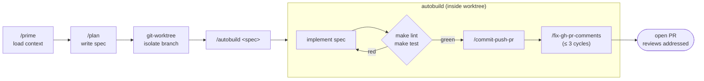
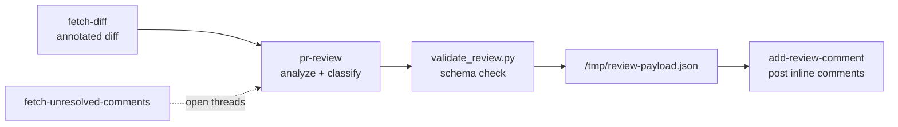

# agent-harness

> `boss-dev` · **v0.33.0** · MIT · part of the [`boss-skills`](../../../README.md) marketplace

Agent harness tooling for Claude Code: subagents, commands, skills, and scripts that build
and operate agentic dev workflows. It bundles several families of skills — a GitHub PR-review
workflow, a git-worktree lifecycle, a release-notes generator, and a portable security-review
skill — alongside planning, priming, and shipping commands, a roster of subagents, and a library
of output styles and status lines.

## Installation

```bash
/plugin marketplace add bossjones/boss-skills   # once
/plugin install agent-harness@boss-skills
```

## Components at a glance

| Component | Count | Auto-active on install? | Invoked as |
| --- | --- | --- | --- |
| [Skills](#skills) | 20 | ✅ Yes | Loaded by Claude when relevant, or `/<skill>` |
| [Commands](#commands) | 16 | ✅ Yes | `/agent-harness:<name>` |
| [Agents](#agents) | 6 | ✅ Yes | Dispatched via the `Agent`/`Task` tool |
| [Output styles](#output-styles) | 7 | ✅ Yes | `/output-style` |
| [Status lines](#status-lines) | 10 | ⚙️ Manual wiring | `statusLine` setting |

Skills, commands, agents, and output styles are discovered and active immediately after
`/plugin install`. Status lines ship as a library and require a one-time
[manual wiring](#manual-wiring) step before they take effect.

## Skills

Skills under `skills/<skill-name>/SKILL.md`. The families below cover the PR-review workflow, the
git-worktree lifecycle, release notes, and machine setup; see [docs/skills.md](./docs/skills.md) for
the complete, current list.

**PR review workflow** (adapted from the [mlflow](https://github.com/mlflow/mlflow) skills,
Apache-2.0):

| Skill | Description |
| --- | --- |
| `fetch-diff` | Fetch a GitHub PR diff with old/new line numbers and auto-generated-file masking, optionally filtered to file globs. |
| `fetch-unresolved-comments` | Fetch only the unresolved PR review threads via the GitHub GraphQL API, grouped by file. |
| `pr-review` | Review a PR and emit a schema-validated local review payload — inline comments plus an approve-or-comment decision. |
| `add-review-comment` | Post a single inline review comment to a PR line or line range via the GitHub API. |

**Git worktree lifecycle** (adapted from
[claude-code-ultimate-guide](https://github.com/FlorianBruniaux/claude-code-ultimate-guide), MIT):

| Skill | Description |
| --- | --- |
| `git-worktree` | Create an isolated worktree for feature development with branch naming, dependency symlinking, and background verification. |
| `git-worktree-status` | Report background type-check, test, and build status for a worktree. |
| `git-worktree-remove` | Safely remove one worktree with branch cleanup and safety checks. |
| `git-worktree-clean` | Batch-clean stale and merged worktrees with a disk-usage report. |

**Release notes** (adapted from claude-code-ultimate-guide, MIT):

| Skill | Description |
| --- | --- |
| `release-notes-generator` | Generate release notes in three formats (CHANGELOG.md, PR body, Slack announcement) from git commits. |

**Machine setup:**

| Skill | Description |
| --- | --- |
| `setup-second-brain` | Install/configure the obsidian-wiki uv tool plus optional [QMD](https://github.com/tobi/qmd) semantic search (detect → preview → apply, with backups and a `--dry-run` diff). Needs `node` ≥ 22 for the optional QMD step. |

**Security review:**

| Skill | Description |
| --- | --- |
| `boss-security-review` | Review changed code (or a named path / whole repo) against a bundled security rubric — and the target repo's `.cursor/rules/security-*` when present — and write a severity-graded findings report to `specs/security-review.md` (path overridable), citing the rule each finding triggered. Portable: bundles verbatim rule copies so it works in any repo. |

**Planning:**

| Skill | Description |
| --- | --- |
| `planf3` | Write implementation plans as self-contained HTML files with synced styling, optional AI-generated diagrams, and a create/update/build lifecycle. |

The `fetch-diff`, `fetch-unresolved-comments`, and `pr-review` skills carry standalone PEP 723
scripts under `scripts/`, invoked with `uv run "${CLAUDE_SKILL_DIR}/scripts/<script>.py"` — `uv`
resolves their dependencies on demand, so the skills work after `/plugin install` with no extra
setup.

## Commands

Sixteen slash commands under `commands/*.md`, auto-discovered on `/plugin install` and namespaced as
`/agent-harness:<name>`.

| Command | Arguments | Purpose |
| --- | --- | --- |
| `prime` | — | Load context for a new session by scanning the codebase, README, and docs. |
| `question` | `[question]` | Answer questions about project structure and docs without writing code. |
| `plan` | `[user prompt]` | Produce a concise engineering plan and save it to the specs directory. |
| `plan_w_team` | `[user prompt] [orchestration prompt]` | Produce a team-orchestrated plan with task dependencies and builder/validator assignments (model: opus). |
| `build` | `[path-to-plan]` | Read a plan file and implement it, then report the completed work. |
| `autobuild` | `<spec-path>` | Implement a spec inside a linked git worktree, then verify, commit, push, open a PR, and address review comments (model: opus). |
| `commit-push-pr` | — | Stage specific files, write a conventional commit, push, and open or reuse a GitHub PR. |
| `fix-gh-pr-comments` | `[pr-number]` | Triage unresolved PR review comments, apply fixes, push, reply and resolve each thread, and poll for new comments (≤ 3 cycles). |
| `debug-ci` | `[run-id]` | Diagnose a failed GitHub Actions run, fix locally, push, and poll the new run until green (≤ 3 cycles). |
| `install_status_line` | `[--check\|--uninstall\|--restore]` | Install the status line into this project's `.claude/settings.local.json` (backed up, reversible). |
| `update_status_line` | `<session_id> <key> <value>` | Upsert a key/value pair into a session's status-line data file. |
| `all_tools` | — | List every available tool as TypeScript-style signatures with purposes. |
| `validate-unicode-hygiene` | `[paths...] [--strict] [--warn-only]` | Scan files for invisible or visually-spoofed Unicode. |
| `docs-tutorial` | `[what to document]` | Generate a tutorial/doc by delegating to `/documentation-generation:doc-generate` with the correct fully-qualified tutorial-engineer subagent; defaults to the current branch's features. |
| `cmux-fresh` | — | Clear cmux's saved session so it boots blank. |
| `cmux-spawn-team` | `[team-name] [feature...] [--config PATH]` | Boot a multi-agent team as a cmux workspace. |
| `cmux-did-spawn` | `<spawn-file path>` | Orient onto a just-spawned team and drive its lead. |

## Agents

Six subagent definitions under `agents/`, auto-discovered on `/plugin install` and namespaced as
`agent-harness:<name>`.

| Agent | Model | Purpose |
| --- | --- | --- |
| `meta-agent` | opus | Generate a complete sub-agent configuration file from a plain-language description. |
| `llm-ai-agents-and-eng-research` | default | Research the latest LLM, AI-agent, and engineering developments. |
| `work-completion-summary` | default | Announce concise audio (TTS) summaries when work finishes. |
| `hello-world-agent` | default | Minimal greeting agent — a template/reference example. |
| `team/builder` | opus | Execute a single engineering task: write code, create files, implement features. |
| `team/validator` | opus | Read-only check that a task met its acceptance criteria. |

`team/builder` and `team/validator` back the `/agent-harness:plan_w_team` orchestration workflow.
`meta-agent`, `llm-ai-agents-and-eng-research`, and `work-completion-summary` reference external MCP
tools (Firecrawl, ElevenLabs) that must be configured separately. Note that Claude Code ignores
`mcpServers` frontmatter on plugin-shipped agents for security, so MCP servers must be configured in
your own settings.

## Workflows

### Plan → worktree → build → ship

The planning and shipping commands chain into a single isolated feature loop. `autobuild` runs only
inside a linked git worktree and reuses `commit-push-pr` and `fix-gh-pr-comments` rather than
duplicating their logic.



```text
/agent-harness:prime
/agent-harness:plan add a --json flag to the download script
# launch an isolated worktree session, then inside it:
/agent-harness:autobuild specs/add-json-flag.md
```

### PR review chain

The four PR-review skills compose. Ask Claude in natural language — it runs the skills in order —
or invoke the bundled scripts directly.



```text
Review PR #142 in this repo and draft inline comments.
```

```bash
# Or drive the scripts directly:
uv run "${CLAUDE_SKILL_DIR}/scripts/fetch_diff.py" --help
```

### Triage CI and review feedback

```text
/agent-harness:debug-ci              # find the failed run, fix, push, poll until green
/agent-harness:fix-gh-pr-comments 142  # apply, reply to, and resolve unresolved review comments
```

## Output styles

Seven output styles under `output-styles/*.md`, auto-discovered on `/plugin install` and selectable
with `/output-style`.

| Style | Description |
| --- | --- |
| `markdown-focused` | Full markdown toolbox — headers, tables, blockquotes, task lists. |
| `bullet-points` | Hierarchical bullet lists, broad to specific. |
| `table-based` | Markdown tables for comparisons, steps, and analysis. |
| `ultra-concise` | Minimal words, fragments over sentences, code-first. |
| `yaml-structured` | Machine-readable YAML with hierarchical key/value blocks. |
| `html-structured` | Semantic HTML5 with data attributes for programmatic use. |
| `genui` | Generative UI — writes a styled, self-contained HTML page to `/tmp/` and opens it. |

## Status lines

`status_lines/` ships ten status-line scripts (PEP 723, `python-dotenv`) — progressively richer
takes on the Claude Code status line. They are a library, not auto-wired: point your `statusLine`
setting at one to use it.

| Script | Shows |
| --- | --- |
| `status_line.py` | Model, directory, git branch, version. |
| `status_line_v2.py` | Adds the last user prompt. |
| `status_line_v3.py` | Adds agent name and the last three prompts (fading). |
| `status_line_v4.py` | Adds custom key/value pairs (see `update_status_line`). |
| `status_line_v5.py` | Session cost, lines added/removed, duration. |
| `status_line_v6.py` | Context-window usage bar and tokens remaining. |
| `status_line_v7.py` | Elapsed session time and start time. |
| `status_line_v8.py` | Input/output token counts and cache stats. |
| `status_line_v9.py` | Minimal powerline layout (model, branch, path, context %). |
| `status_line_v10.py` | Leading `[auth:subscription]`/`[auth:api]`/`[auth:pending]` auth label (an inference — `subscription` covers both Pro and Max), context-window usage bar, plus a running session cost from list pricing. |

## Manual wiring

Status lines are the opt-in component: point your `statusLine` setting at one of the scripts:

```json
{
  "statusLine": {
    "type": "command",
    "command": "uv run \"${CLAUDE_PLUGIN_ROOT}\"/status_lines/status_line_v10.py"
  }
}
```

## Status

Plugin version **v0.33.0**. Skills, commands, agents, and output styles are
auto-discovered and active on `/plugin install`. Status lines require a `statusLine` setting.

## See also

- Expanded reference: [`docs/plugins/agent-harness.md`](../../../docs/plugins/agent-harness.md)
- Marketplace index: [`docs/plugins/README.md`](../../../docs/plugins/README.md)
- Repo root: [`README.md`](../../../README.md)
